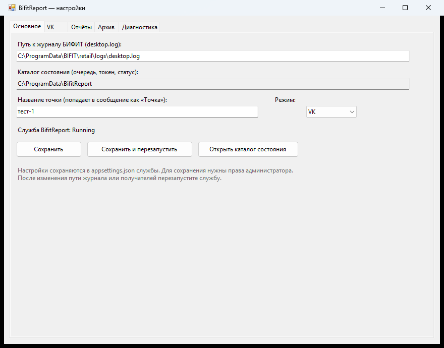

# BIFIT Report

Безопасный фоновый агент для Windows, который читает журнал «БИФИТ Касса / Касса Розница», формирует эксплуатационные отчёты и отправляет их в сообщения сообщества ВКонтакте.

Агент работает **отдельно от кассового приложения**:

- открывает `desktop.log` только для чтения с `FileShare.ReadWrite | FileShare.Delete`;
- не подключается к рабочей H2-базе `data.mv.db`;
- не внедряется в процесс кассы и не устанавливает плагин;
- не блокирует ротацию журнала;
- при сбое или отсутствии интернета не влияет на продажи — сообщения остаются в дисковой очереди.

## Какие события распознаются

- открытие и закрытие смены;
- успешная регистрация чека;
- удаление незавершённого чека;
- сумма и результат сопряжённой банковской операции;
- критические ошибки ККТ, фискализации, терминала, синхронизации и маркировки;
- критические ошибки плагинов, локальной базы и фатальные сбои приложения;
- обычные ошибки для счётчика итогового отчёта.

Если агент запущен в середине смены (первая установка, перезапуск службы), открытие смены он не видит, но все последующие операции всё равно попадают в отчёт: при закрытии смены такой отчёт помечается «Данные неполные» и содержит наблюдённые чеки, суммы и ошибки. Запоздалые строки синхронизации уже закрытой смены не сбрасывают счётчики текущей.

Важно: журнал не содержит полную структурированную информацию обо всех оплатах. Поле «Распознанная сумма терминала» — это только сумма найденных успешных терминальных операций, а не бухгалтерская выручка. Наличные, смешанные оплаты, возвраты и товарный состав чека нельзя надёжно восстановить только из `desktop.log`.

## Защита данных

- полные строки журнала в VK не отправляются: для критической ошибки допускается только очищенный фрагмент исключения (по умолчанию до 8 строк и 900 символов);
- отчёты строятся из разрешённого набора полей;
- банковские слипы, номера карт, e-mail, телефоны, токены и длинные идентификаторы отсекаются даже внутри фрагмента исключения;
- токен VK хранится в отдельном DPAPI-файле (`LocalMachine`), а каталог секретов ограничивается для `SYSTEM`, администраторов и пользователя, сохранившего токен;
- повторная отправка защищена постоянными маркерами и детерминированным `random_id`.

## Требования

- Windows 10/11 x64 или Windows Server x64;
- .NET 8 Runtime — только для framework-dependent публикации; инсталлятор и portable-архив с GitHub Releases содержат self-contained сборку, и .NET на кассе не нужен;
- .NET Framework 4.8 — для графического настройщика (уже есть в Windows 10 1903+ и Windows 11);
- «БИФИТ Касса / Касса Розница» с журналом по умолчанию:
  `C:\ProgramData\BIFIT\retail\logs\desktop.log`;
- сообщество VK с включёнными сообщениями и ключом с правом `messages`.

## Установка из GitHub Releases

Готовые сборки публикуются на странице [Releases](https://github.com/Arseniys1/bifit-report/releases).

1. Скачайте `BifitReport-<версия>-setup.exe` из последнего релиза.
2. Запустите файл от имени администратора — двойной щелчок, Windows сама запросит UAC.
3. Мастер установит программу в `C:\Program Files\BifitReport`, зарегистрирует службу `BifitReport` и запустит её. На последнем шаге отметьте «Открыть настройщик BIFIT Report».
4. В настройщике укажите путь к журналу, имя точки и режим доставки; для режима VK сохраните токен и получателей. Нажмите «Сохранить» — служба перезапустится с новыми настройками.

Что делает инсталлятор:

- копирует агент, настройщик и скрипты в `C:\Program Files\BifitReport`;
- создаёт каталог состояния `C:\ProgramData\BifitReport` и ограничивает доступ к нему (`SYSTEM` и администраторы);
- регистрирует службу `BifitReport` с автозапуском;
- сам ничего не отправляет в сеть: до настройки режима `VK` служба работает в безопасном режиме `File` и только пишет `delivery-preview.log`.

**Обновление.** Запустите инсталлятор новой версии поверх старой. Служба останавливается, файлы заменяются, а `appsettings.json`, состояние, очередь и DPAPI-токен сохраняются: имя точки, режим доставки, получатели и настройки архива не сбрасываются.

**Удаление.** «Параметры → Приложения» → BIFIT Report → Удалить. Служба и файлы программы удаляются, а состояние в `C:\ProgramData\BifitReport` — нет: после переустановки история и очередь продолжатся. Файл `C:\Program Files\BifitReport\appsettings.json` удаляется вместе с программой — если настройки (имя точки, режим VK, получатели, архив) понадобятся после переустановки, сохраните его заранее; состояние, очередь и DPAPI-токен при этом не затрагиваются. Чтобы удалить и состояние, выполните до удаления:

```powershell
& "C:\Program Files\BifitReport\scripts\uninstall-service.ps1" -RemoveState
```

или после удаления:

```powershell
Remove-Item "C:\ProgramData\BifitReport" -Recurse -Force
```

**Инсталлятор не подписан**, поэтому SmartScreen или антивирус может показать предупреждение. Если это неприемлемо на кассах, используйте portable-архив и `scripts\install-service.ps1` (см. ниже) либо подпишите сборку сертификатом.

**Portable-архив** `BifitReport-<версия>-portable-win-x64.zip` — та же self-contained сборка без инсталлятора: распакуйте её на кассе и запустите `scripts\install-service.ps1` от администратора. Контрольные суммы всех файлов релиза лежат в `SHA256SUMS.txt`; проверка:

```powershell
Get-FileHash .\BifitReport-1.0.0-setup.exe -Algorithm SHA256
```

## Сборка и тесты

```powershell
dotnet restore BifitReport.sln
dotnet build BifitReport.sln -c Release --no-restore
dotnet test BifitReport.sln -c Release --no-build
```

Публикация:

```powershell
.\scripts\publish.ps1
```

Результат появится в `artifacts\publish\win-x64`.

## Выпуск релиза

Релиз собирается в GitHub Actions (`.github/workflows/release.yml`) и автоматически появляется на странице Releases. Достаточно поставить тег на нужный коммит:

```powershell
git tag v1.0.0
git push origin v1.0.0
```

Workflow соберёт self-contained публикацию, portable-архив и инсталлятор Inno Setup, посчитает SHA256 и создаст релиз с вложениями:

- `BifitReport-<версия>-setup.exe` — инсталлятор;
- `BifitReport-<версия>-portable-win-x64.zip` — portable-сборка для установки скриптами;
- `SHA256SUMS.txt` — контрольные суммы.

Примечания к релизу собираются из коммитов после предыдущего тега. Если нужно выпустить черновик без тега: Actions → Release → Run workflow, указать версию и включить `draft`.

Локальная сборка тех же артефактов:

```powershell
.\scripts\build-release.ps1 -Version 1.0.0
```

Нужны .NET 8 SDK и Inno Setup 6 (`winget install JRSoftware.InnoSetup`); результат — в `dist\`. Версия должна иметь вид `MAJOR.MINOR.PATCH` без префикса `v`: она попадает в имя инсталлятора, свойства exe и имя тега. Job `installer-smoke` в CI проверяет, что инсталлятор собирается на каждом pull request.

## Безопасная локальная проверка

По умолчанию включён режим `Delivery:Mode = File`. Сформированные сообщения записываются в:

```text
C:\ProgramData\BifitReport\delivery-preview.log
```

Так можно проверить отчёты на работающей кассе без передачи данных наружу. При первом запуске агент начинает с конца текущего лога (`StartFromEndOnFirstRun = true`) и не рассылает старую историю.

Для запуска из исходников создайте игнорируемый Git-файл `src\BifitReport.Agent\appsettings.local.json`:

```json
{
  "Agent": {
    "LogPath": "C:\\ProgramData\\BIFIT\\retail\\logs\\desktop.log",
    "StateDirectory": "C:\\ProgramData\\BifitReport-Dev"
  },
  "Delivery": {
    "Mode": "File"
  },
  "Reports": {
    "StoreName": "Магазин 1"
  }
}
```

Затем:

```powershell
dotnet run --project .\src\BifitReport.Agent\BifitReport.Agent.csproj -c Release
```

Текущее состояние наблюдателя записывается в `status.json`, позиция журнала — в `tail-checkpoint.json`, накопители смены — в `report-state.json`.

## Установка как службы Windows

Запустите PowerShell от имени администратора:

```powershell
.\scripts\publish.ps1
.\scripts\install-service.ps1 `
  -LogPath "C:\ProgramData\BIFIT\retail\logs\desktop.log" `
  -StoreName "Магазин 1" `
  -Mode File
```

Служба называется `BifitReport`. В режиме `File` она уже полностью работает, но ничего не отправляет в сеть.

### Установка на кассы (несколько компьютеров)

1. На машине сборки:

   ```powershell
   .\scripts\publish.ps1 -SelfContained
   ```

   Получится `artifacts\publish\win-x64-selfcontained` — его можно целиком копировать на кассу, .NET на ней не нужен. Без `-SelfContained` публикация меньше, но на каждой кассе потребуется .NET 8 Runtime. Скрипты установки копируются в подкаталог `scripts\` публикации.

2. Скопируйте каталог публикации на кассу, например в `C:\Temp\BifitReport`.

3. На каждой кассе в PowerShell **от администратора**, из каталога публикации:

   ```powershell
   .\scripts\set-vk-token.ps1
   .\scripts\install-service.ps1 `
     -LogPath "C:\ProgramData\BIFIT\retail\logs\desktop.log" `
     -StoreName "Карагай-1" `
     -Mode VK `
     -PeerIds 2000000001 `
     -ArchiveEnabled `
     -ArchiveDestination "E:\bifit\archive\bifit-logs"
   ```

   `-PublishPath` не нужен: скрипт находит `BifitReport.Agent.exe` рядом с собой. Имя источника архива по умолчанию берётся из `-StoreName` (можно задать явно через `-ArchiveSourceName`).

4. Повторите для каждой кассы, меняя `-StoreName` — оно попадает в сообщение как «Точка: ...». `-PeerIds` может быть общим чатом или отдельным для точки.

5. Проверка на кассе:

   ```powershell
   Get-Service BifitReport
   Get-Content C:\ProgramData\BifitReport\status.json
   Get-Content C:\ProgramData\BifitReport\archive-status.json
   .\scripts\send-test-vk.ps1 -PeerId 2000000001
   ```

Важно:

- **Токен VK шифруется DPAPI в области `LocalMachine` и привязан к компьютеру.** Скопировать `vk-token.dat` с одной кассы на другую нельзя — на каждой выполните `set-vk-token.ps1` (токен сообщества при этом один и тот же).
- Служба работает от `LocalSystem`. Для архива на сетевом ресурсе (`\\server\share`) этому аккаунту нужен доступ; в рабочей группе проще архивировать локально и синхронизировать позже.
- `install-service.ps1` удаляет `appsettings.local.json` из каталога установки, чтобы тестовые настройки не перекрыли боевые.
- Обновление: скопируйте новый каталог публикации и запустите `install-service.ps1` с теми же параметрами — служба остановится, файлы обновятся, состояние и очередь сохранятся.
- Удаление: `.\scripts\uninstall-service.ps1`; состояние сохраняется, для удаления состояния добавьте `-RemoveState`.

### Графический настройщик



На кассе после установки запустите:

```text
C:\Program Files\BifitReport\BifitReport.Settings.exe
```

Двойной щелчок — приложение само запросит повышение прав (UAC). PowerShell не нужен: это отдельный exe под .NET Framework 4.8, который уже есть в Windows 10. Файл также лежит в каталоге публикации рядом с `BifitReport.Agent.exe`.

Что умеет:

- править путь к журналу, имя точки, режим доставки и получателей VK;
- сохранять токен VK через DPAPI (ввод скрыт, токен не показывается);
- проверять токен и список доступных диалогов, отправлять тестовое сообщение;
- включать/выключать отчёты, менять cooldown и лимиты фрагмента стека;
- настраивать архив: каталог назначения и источники;
- показывать `status.json`, `archive-status.json` и размер очереди;
- сохранять настройки и перезапускать службу.

Файл настроек — `appsettings.json` рядом с exe (`C:\Program Files\BifitReport\appsettings.json`); для сохранения нужны права администратора. Для тестового запуска можно указать другой файл: `BifitReport.Settings.exe --config D:\test\appsettings.json --no-elevate`.

## Подключение VK

1. Создайте ключ доступа сообщества с правом на сообщения.
2. Пользователь должен разрешить сообщения сообщества либо добавить бота сообщества в беседу.
3. Сохраните ключ через DPAPI **на каждой кассе** (файл токена привязан к компьютеру):

```powershell
.\scripts\set-vk-token.ps1
```

Проверить токен и увидеть доступные `peer_id` без отправки сообщений:

```powershell
.\scripts\check-vk.ps1
```

Если список диалогов пуст, сначала отправьте любое сообщение со своей страницы сообществу. После появления `peer_id` можно выполнить явную тестовую отправку:

```powershell
.\scripts\send-test-vk.ps1 -PeerId 123456789
```

4. Переустановите/обновите конфигурацию службы, указав проверенных получателей:

```powershell
.\scripts\install-service.ps1 `
  -LogPath "C:\ProgramData\BIFIT\retail\logs\desktop.log" `
  -StoreName "Магазин 1" `
  -Mode VK `
  -PeerIds 123456789
```

Для беседы `peer_id` обычно имеет вид `2000000000 + chat_id`. Можно указать несколько получателей.

Токен также можно передать переменной окружения `BIFIT_REPORT_VK_TOKEN`, но для службы рекомендуется DPAPI-файл.

## Настройки отчётов

Основные параметры `appsettings.json`:

| Параметр | Назначение |
|---|---|
| `Agent:StartFromEndOnFirstRun` | Не обрабатывать старую историю при первой установке |
| `Delivery:Mode` | `File` для предпросмотра или `VK` для отправки |
| `Vk:PeerIds` | Получатели сообщений |
| `Reports:SendShiftOpened` | Уведомлять об открытии смены |
| `Reports:SendShiftClosed` | Отправлять итог при закрытии |
| `Reports:SendImmediateCriticalErrors` | Немедленные аварийные уведомления |
| `Reports:CriticalErrorCooldownMinutes` | Защита от шквала одинаковых ошибок |
| `Reports:PeriodicSummaryEnabled` | Включить промежуточные отчёты |
| `Reports:PeriodicSummaryMinutes` | Период промежуточного отчёта |
| `Reports:IncludeSanitizedErrorMessage` | Добавлять очищенный текст ошибки; по умолчанию включено |
| `Reports:IncludeExceptionDetails` | Добавлять очищенный фрагмент стека/исключения; по умолчанию включено |
| `Reports:MaxExceptionLines` | Максимум строк фрагмента (по умолчанию 8) |
| `Reports:MaxExceptionCharacters` | Максимум символов фрагмента (по умолчанию 900) |
| `Vk:DeadLetterAttempts` | Сколько раз повторять неустранимую ошибку VK до переноса в `queue\failed` (по умолчанию 3) |

Критический алерт с фрагментом исключения занимает около 1–1,5 КБ при лимите VK в 9000 символов; клиент дополнительно страхует отправку обрезкой до 4000 символов.

В режиме `Delivery:Mode = VK` список `Vk:PeerIds` обязателен: без получателей агент не стартует и сообщает об ошибке в журнале запуска. Сообщения отправляются в порядке событий кассы, поэтому открытие и закрытие смены не перемешиваются.

Сетевые ошибки повторяются с экспоненциальной задержкой до `Vk:MaximumRetryDelayMinutes`. Если VK отвечает неустранимой ошибкой (например, `917` — нет доступа к диалогу), отчёт повторяется `Vk:DeadLetterAttempts` раз и затем переносится в `queue\failed` вместе с причиной: бесконечного цикла повторов и разрастания очереди не будет, а текст отчёта остаётся на диске для разбора.

Параметры можно переопределять переменными окружения с префиксом `BIFIT_REPORT_`, например:

```text
BIFIT_REPORT_Agent__LogPath=C:\ProgramData\BIFIT\retail\logs\desktop.log
```

## Архивирование журналов

БИФИТ хранит ротированные журналы ограниченное время (около трёх месяцев) и затем удаляет их. Агент может копировать ротированные файлы в отдельный каталог, чтобы история не терялась. Источник только читается: агент ничего не удаляет и не изменяет в журналах кассы.

```json
"Archive": {
  "Enabled": true,
  "Destination": "E:\\bifit\\archive\\bifit-logs",
  "Sources": [
    { "Name": "bifit-kassa", "Path": "C:\\ProgramData\\BIFIT\\retail\\logs" }
  ],
  "Patterns": [ "desktop-*.log.gz", "chzn-*.log.gz", "launcher*.log" ],
  "MinFileAgeMinutes": 10,
  "PollIntervalMinutes": 60
}
```

Файлы раскладываются как `Destination\<Name>\<имя файла>`. Уже скопированные неизменённые файлы пропускаются, изменённые копируются заново. Живой `desktop.log` намеренно не копируется: после ротации он появится в виде `desktop-*.log.gz` и будет сохранён. Файлы моложе `MinFileAgeMinutes` не трогаются, чтобы не копировать недописанный журнал.

| Параметр | Назначение |
|---|---|
| `Archive:Enabled` | Включить фоновое копирование |
| `Archive:Destination` | Корневой каталог архива (лучше другой диск или сетевой ресурс) |
| `Archive:Sources` | Список `Name` + `Path` каталогов журналов (локальных или UNC) |
| `Archive:Patterns` | Маски сохраняемых файлов |
| `Archive:MinFileAgeMinutes` | Не копировать файлы, изменённые менее N минут назад |
| `Archive:PollIntervalMinutes` | Период проверки новых файлов |

Журнал работы и статистика архива пишутся в `archive-status.json` рядом с `status.json`.

### Несколько касс

- **Агент на каждой кассе, общий архив.** На каждой кассе укажите свой `Name` и общий `Destination`, например `\\server\bifit-logs`. Службе нужны права на запись в этот ресурс.
- **Один агент, несколько источников.** Если папки касс доступны по сети, перечислите их в `Sources` (например, `\\kassa1\C$\ProgramData\BIFIT\retail\logs`). Учётной записи службы нужны права на чтение этих ресурсов.
- **Уже сделанные выгрузки.** Каталоги из `eofd` можно добавить в `Sources` как отдельные имена — агент сведёт их в один архив (файлы будут скопированы повторно, ~700 МБ).

## Отказоустойчивость

- контрольная позиция учитывает обрезку, перезапись и замену `desktop.log`: кроме длины файла сравнивается отпечаток его начала, поэтому подмена файла с сохранённым временем создания (NTFS tunneling) не приводит к чтению с середины;
- незавершённая UTF-8 строка сохраняется до следующего чтения;
- обработанные события имеют устойчивые идентификаторы;
- сообщения лежат в `queue\pending` до подтверждённой доставки;
- при нескольких получателях прогресс сохраняется отдельно для каждого;
- сетевые ошибки повторяются с экспоненциальной задержкой, неустранимые — ограниченное число раз, после чего попадают в `queue\failed` вместе с причиной;
- сбой одного фонового обработчика (журнал, очередь, архив) не останавливает службу: ошибка пишется в журнал, остальные обработчики продолжают работу, а сама служба настроена на автоперезапуск средствами SCM (`sc failure`);
- запись `status.json` — диагностика: недоступный каталог состояния не прерывает наблюдение за журналом и доставку;
- ошибка агента не завершает и не изменяет БИФИТ Кассу.

## Удаление службы

На каждой кассе в PowerShell **от администратора**:

```powershell
& "C:\Program Files\BifitReport\scripts\uninstall-service.ps1" -RemoveState
```

Скрипт останавливает и удаляет службу `BifitReport`, останавливает вручную запущенный агент, удаляет каталог программы и — с `-RemoveState` — состояние: очередь, контрольные точки и DPAPI-токен. **Архив журналов (`Archive:Destination`) не удаляется**, его нужно очистить отдельно.

- Без `-RemoveState` состояние сохраняется: после переустановки история и очередь продолжатся.
- `-KeepFiles` оставляет файлы программы, удаляя только службу.
- Путь установки и состояния можно переопределить: `-InstallPath`, `-StateDirectory`.

Если скрипта под рукой нет, удаление вручную:

```powershell
Stop-Service BifitReport -Force -ErrorAction SilentlyContinue
sc.exe delete BifitReport
Get-Process BifitReport.Agent -ErrorAction SilentlyContinue | Stop-Process -Force
Remove-Item "C:\Program Files\BifitReport" -Recurse -Force
Remove-Item "C:\ProgramData\BifitReport" -Recurse -Force   # только если состояние больше не нужно
```

Проверка:

```powershell
Get-Service BifitReport -ErrorAction SilentlyContinue   # ничего не должно найтись
Test-Path "C:\Program Files\BifitReport"                # False
Test-Path "C:\ProgramData\BifitReport"                  # False, если был -RemoveState
Get-Process BifitReport.Agent -ErrorAction SilentlyContinue
```

Несколько касс сразу (если включён WinRM и есть права администратора на них):

```powershell
Invoke-Command -ComputerName kassa1,kassa2,kassa3 -ScriptBlock {
    & "C:\Program Files\BifitReport\scripts\uninstall-service.ps1" -RemoveState
}
```

Если WinRM недоступен, зайдите на каждую кассу по RDP и запустите скрипт от администратора. БИФИТ Касса, её база и журналы при удалении не затрагиваются.
